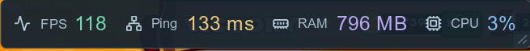

# Benchmark

Live FPS and ping, gameplay recordings and controlled animation tests for Dungeon Rampage Haxe.

<!-- drh:show -->
A small, movable FPS and ping display works in town, loading screens and dungeons. Drag the panel to move it or its bottom-right corner to resize it. It can sit against the screen edges. FPS is green and ping is amber; unavailable values show a dash. Press F7 to show or hide the panel without stopping a recording. Rebind Show / hide Benchmark under Settings > CONTROLS > Benchmark. The game or OS can throttle rendering when unfocused.

**Show CPU, Show texture memory (VRAM) and Show Haxe heap (RAM)** (Settings > Mods > Benchmark, off by default) add those readings to the compact display and the Full Benchmark window, in the order FPS, CPU, Textures (VRAM), Heap (RAM), Ping. CPU is the game's share of your whole processor (where the thread count is unknown, the number of cores the game uses). Textures is the graphics memory the game's renderer allocated, by its own count: not the game's whole VRAM use, which is often far more. Heap is the Haxe heap, the memory of the game's code: about half of what Task Manager shows for the game. They update once a second at almost no cost.

**Full Benchmark is off by default.** Enable it in Settings > Mods > Benchmark for recording controls and detailed results. With it off, the display does not record performance history, scan animations or profile mods. It only counts frame callbacks, reads the existing heartbeat and refreshes text twice per second. The full panel resizes from its corner too; both panels open at the same spot and each keeps its own size.

**Record normal gameplay:** press Start, play, then press Stop. Stop saves local logs and opens a movable, scrollable results window with a readable summary. Details shows timings, scene context, sampled animations and diagnostic warnings. Copy exports the full text. Results reopens the last gameplay recording.

**Test animations:** in town, choose Start full benchmark and confirm the warning. Heavy scenes can freeze or crash the game. Completed rounds are saved automatically. The test uses the game's room artwork, four heroes, dragon breath, Battleheim Lion Fury, an explosion and every hero's ultimate. Eleven scenes compare 16 copies of each effect, then all ultimates play together. Mixed scenes increase the load. Eighteen rounds aim to finish within about a minute and a half; loading and preparation count toward the limit and can leave partial results.

Each round is saved locally. After an interrupted test, recovered results open on restart. Last full result reopens the saved animation report. The checkpoint identifies the last attempted operation or active animation set, not a proven crash cause. The test continues unfocused while frame callbacks run; background conditions can affect comparisons. Leaving town or changing the viewport stops it. The town interface is temporarily hidden and restored afterward.

Animation results show FPS for each scene and rank matched effect tests. These are visual tests, without enemy AI, physics or server combat. Gameplay animation correlations are clues, not proven causes.

CPU, GPU and process RAM are optional Windows-only readings from the supplied manual process sampler. Unsupported metrics are hidden. It measures only the selected game process and is never started automatically. Benchmark also works without it.

Logs stay in the mod's local data folder; nothing is uploaded automatically. Older reports can include enabled mod names, IDs and versions, so review before sharing. New reports mark enabled-mod enumeration unavailable; note your enabled set manually when comparing runs. Disabling Full Benchmark stops and saves an active gameplay recording. This mod measures performance; it does not improve FPS or provide a graphics preset.
Missing or incompatible game assets stop the controlled test or skip the affected round with an error instead of escaping into normal gameplay. Native crashes and driver failures cannot be guaranteed recoverable.
<!-- /drh:show -->



## Installation and controls

Install the release through the DRH Launcher, enable Benchmark and restart the game. Keep API enabled. The default compact display appears near the top center. Move it away from native HUD elements if needed. MODS settings: Full Benchmark and the three Show switches; recording controls belong to the full panel. No extra keyboard bindings are installed.

The mod declares API 1.5.0 and uses native DRH 18 and 19 contracts through `extends`. New game versions can require adapter updates. Gameplay recordings and a complete controlled run have been exercised by the author on DRH 18 and 19. The controlled protocol completed in 57.5 seconds at a 1920 x 1080 viewport. These observations are not a guarantee for every platform, driver or enabled-mod combination.

## Results and files

The full panel has two separate tools:

- Start, Stop and Results record and reopen normal gameplay.
- Start full benchmark and Last full result run and reopen the controlled animation test in town.

All files are under the launcher's persistent `mods/data/benchmark` folder for that installation or sandbox:

- `report.txt`: readable gameplay results.
- `report.json`: gameplay summary and diagnostic evidence.
- `benchmark.jsonl`, `.1` and `.2`: up to three 1 MiB rotating gameplay log chunks.
- `capacity-0.json` and `capacity-1.json`: alternating controlled-test checkpoints. The preceding valid slot is retained if a write fails. This supports game-crash recovery, not protection against disk failure or power loss.
- `ui.json` and `lite-ui.json`: panel layouts.
- `attach.json` and optional `process.json`: manual process-sampler session data.
- `recording-errors.json`: recording failures when present.

Only an explicitly started recording or controlled test writes diagnostic measurements. Compact mode may save layout changes and read previous recovery state. It does not collect a performance history. The mod does not collect chat, tokens or server addresses. Native asset identifiers remain visible in reports. Reports from older versions can also contain enabled-mod names.

## Controlled protocol 6

Each scene has 250 ms warm-up and four seconds of measured progression. Loading, preparation, instance creation and checkpoint writes are excluded from the measured phase but included in the 60-second wall limit. A slow system can produce partial or skipped stages. A sustained foreground result below 5 FPS, a missing renderer or other failure can end the test early. Missing assets are reported instead of silently replaced.

The same four randomly chosen distinct heroes and castle room artwork remain throughout a run. The report records the heroes; compare the same hero selection, protocol, viewport, focus conditions and enabled mods. Their repeating sequence includes idle, directional runs, a synchronized shared circle and a running dance. The popup scales with the viewport; a rectangular mask confines scene artwork to the content region.

Stages:

1. Four-hero room baseline.
2. Dragon body with authored frost-breath attachment.
3. Battleheim Lion Fury / Ally Frenzy.
4. Six separate scenes: 16 firebomb explosions, Berserker ultimates, Sorcerer ultimates, Ranger flares, ultimate bursts and Chef meteors.
5. Mixed ultimate scenes with 40 and 120 added animations.
6. Extreme mixed finale with 160 added animations.

Effects use game-relative authored scales, including native firebomb and Chef multipliers. All artwork loads from the installed game at runtime; no game artwork is redistributed here. Lion Fury uses ALPHA_TIGER, its roar and Ally Frenzy flame/shockwave artwork with the maximum red/orange tint. It does not reproduce the full buff tween or gameplay state machine.

Actual native surface traversals must occur for a round to qualify. Saved operations identify assets and instance counts before loading, creation, measurement and disposal. Recovery reports the last durable operation, which alone cannot establish what caused a native crash. The suite never automatically restarts after interruption.

## How to interpret measurements

- FPS describes the complete scene. It is not FPS consumed by one animation. A single-frame FPS equivalent is the reciprocal of frame duration, not a measured one-second rate.
- p95/p99 frame times describe slower frames. Higher values mean more uneven pacing. The histogram has 1 ms resolution.
- Six isolated comparisons use the same count and placement, but differ in artwork, composition and screen coverage. They narrow candidates; they do not measure exact per-effect GPU time. Repeat runs before drawing conclusions.
- Mixed crowds show capacity, not which one effect caused a drop. An effect staying at the frame cap still has a cost.
- Native animation advance timing excludes GPU rendering. There is no GPU fence timing, function self-time or per-animation RAM ownership.
- Normal recording snapshots are bounded and sampled, so brief animations can be missed. Actor and symbol rows can overlap. Reports include sample age, partial scans, exclusions and adapter errors.
- Normal recording excludes unfocused, suspended and profiler-heavy intervals from diagnostic attribution. Controlled tests can continue unfocused and mark background intervals; the OS can still suspend callbacks.
- Ping reads the existing server heartbeat without sending new requests. It can include local scheduling delay and may be unavailable during loading.
- Cross-mod enumeration and timing are unavailable through API 1.5.0. New recordings do not inspect enabled.json, infer the mods folder from the data path, or locate overlays by internal names. Older saved reports retain their historical observations, which remain incomplete wall-time samples, not CPU percentages or FPS loss.

## Optional Windows process sampler

The API does not expose portable full-process GPU utilization or working-set RAM. `Resources/Measure-Game.ps1` is readable PowerShell source and is never launched by the mod. After starting a gameplay recording, find the game's PID in Task Manager > Details and run:

```powershell
powershell -NoProfile -File "C:\path\to\benchmark\Resources\Measure-Game.ps1" -GameProcessId 1234 -BenchmarkData "C:\path\to\mods\data\benchmark"
```

Use that exact installation's data folder. Start a new sampler for each recording. Stop ends its session; Ctrl+C also stops it. It checks process identity and session ID and rejects the launcher. Readings older than six seconds are discarded. No elevation or shell launch is requested by the mod.

CPU is the process CPU-time delta as a percentage of total logical CPU capacity. RAM is the process working set in MiB/GiB, displayed as MB/GB. GPU is the busiest available GPU engine for that PID, not whole-device utilization. Driver support, Windows version and localized counter names can make GPU unavailable. There is no whole-PC fallback. The sampler is Windows-only; the in-game recorder does not require it.

## Development and license

Mod code is GPL-3.0; see LICENSE. Lucide outlines use the ISC license in `Resources/LUCIDE-LICENSE.txt`. This project uses the public mod API and native game contracts, not another indexed mod as a replacement.

- [Mod API reference](https://github.com/Tutez64/DRH-Mod-API/blob/master/docs/api.md)
- [Mod development and publishing rules](https://github.com/Tutez64/Dungeon-Rampage-Haxe/blob/master/docs/making-a-mod.md)

Run `python tests/run.py --haxe PATH_TO_HAXE` for offline regression fixtures. These use doubles and do not establish native compilation or GPU performance. The official release workflow packs the mod and matching launcher JSON. Source and release audits check UTF-8 text, decoded JSON, file contents and package checksums.

## Changes in 0.1.29

Each scene's drop against the baseline also shows as a share of it, in its own colour: green up to a third slower, amber up to two thirds, red beyond. The FPS label keeps its colour, so a scene can read both "smooth" and "much slower than the baseline".

## Changes in 0.1.28

The full benchmark covers every hero's ultimate: the Pyromancer, Dragon Knight, Vampire Hunter and Ghost Samurai ultimates each get their own round, and a new round plays all heroes' ultimates together. The time limit grows to match. The switch descriptions are shorter, so they fit in the Mods settings.

## Changes in 0.1.27

The readings are named for what they measure: GPU VRAM is now Textures (VRAM) (the renderer's own count of what it allocated, not the game's whole VRAM use) and RAM is now Heap (RAM) (the Haxe heap, about half of what the process holds). CPU reads the thread count from /proc/cpuinfo on Linux; where it is unknown it shows the cores the game uses instead of a clamped 100%. Reports and captions carry the current version. The compact display's default spot no longer covers the gold and gem counters. The Full Benchmark panel can be resized from its bottom-right corner like the compact display, and both open at the same spot: moving one moves the other (each keeps its own size). The compact display starts at normal size instead of about half.

## Changes in 0.1.24

Three new MODS switches, Show CPU, Show GPU VRAM and Show game RAM usage, add those readings to the compact display and the Full Benchmark window: FPS, CPU, GPU VRAM, RAM, Ping. In the full window the optional process sampler's CPU and RAM take precedence, and its GPU load shows as its own card. CPU is the game's share of the whole processor; GPU VRAM is the graphics memory held by the game's textures and buffers; RAM is the memory the game uses. They are read once a second inside the game, without the process sampler. A GPU load reading is not available from inside the game, so it is not offered. The compact display sizes each reading to its value, with even gaps.

## Review corrections in 0.1.23

Animation context has a separate heading from historical mod spans. Caught layout, checkpoint, cleanup and session-file errors produce bounded game-log warnings, with repeat counts in new gameplay reports. Missing optional files on first use are normal. F7 toggles the panel through the public CONTROLS API without changing recording state. Unsupported cross-mod probing has been removed.

## Asset and interface safeguards

Missing textures, animation symbols, labels or required renderer interfaces produce an error or an explicitly skipped round. Load timeouts are bounded. Startup, update, loader-probe and render failures stop only the controlled test; partial instances are cleaned independently and the prior town UI visibility is restored. Late callbacks cannot restart a stopped test. These guards handle detectable Haxe errors; they cannot guarantee recovery from native crashes, GPU/driver faults or every incompatible game update.
